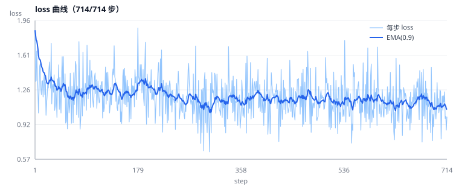

# 01 · 监督微调（SFT）

[← 上一节：开始之前](../00-开始之前/README.md) · [总目录](../README.md) · [下一节：蒸馏 →](../02-蒸馏/README.md)

---

## 1. 一句话定义

**把"一个更强的模型是怎样一步步解决任务"的完整录像，当成标准答案让它背下来。**

这是整条后训练流水线的**第 1 步**，也是后面所有步骤的地基：没有 SFT，模型连"工具调用"的格式都不会写，RL阶段根本无从采样。

---

## 2. 原文译文 · 1. Supervised fine-tuning (SFT)

> 模型学会复制 **agent 轨迹**——也就是 agent 解决一个任务的过程记录，其中包含每一次工具调用及其结果，通常由更强的模型产生。这一步便宜且稳定。
>
> 模型只会见到**正确的**轨迹，永远见不到它自己的尝试。当它在解题过程中犯了错，它并没有学过如何从错误中恢复。**On-policy 蒸馏**和 **RL** 通过在模型自己的输出上训练来解决这个问题。

### 原文推荐资源

| 类型 | 链接 |
|---|---|
| Watch | [Training Agents 1: fine-tune a coding agent](https://www.youtube.com/watch?v=rNgUoH7Wbv8)（[代码](https://huggingface.co/burtenshaw/gemma4-pi-mono-youtube-livestream-1-scripts)） |
| Read | [Training Agents: Class 1, SFT from scratch](https://x.com/ben_burtenshaw/status/2067615361428545566) |
| Docs | [SFT Trainer](https://huggingface.co/docs/trl/sft_trainer) |

---

## 3. 训练信号从哪来

| 环节 | 内容 |
|---|---|
| **输入** | `(system prompt + 工具列表 + 用户任务 + 完整正确轨迹)` |
| **模型产出** | 每个位置的下一个 token 分布 |
| **监督信号** | 数据里那一个**确定的 token**（硬标签，one-hot） |
| **损失** | 只在 assistant 的 token 上算的交叉熵：`-Σ log p(y_t)` |
| **产物** | 一个会模仿该轨迹（格式、顺序、风格）的模型 |

```
数据：   "先 read_file → 看到 bug → write_file → run_tests → 通过"
                    │
                    ▼
训练：   强制模型在每个位置都预测出数据里的那个 token
                    │
                    ▼
效果：   模型学会「这个任务该按这个顺序、用这些工具、这样写参数」
         但没学会「如果我刚才猜错了怎么办」（因为数据里从没有错误）
```

---

## 4. 数据格式：一条 agent 轨迹长什么样

### 4.1 SFTTrainer 支持的 4 种数据集格式

| 格式 | 列 | 适用 |
|---|---|---|
| 标准 LM | `text` | 纯文本续写 |
| 对话 LM | `messages` | **agent 轨迹就用这个**（角色 + 工具调用都在里面） |
| 标准 prompt-completion | `prompt`, `completion` | 单轮问答 |
| 对话 prompt-completion | `prompt`(messages), `completion`(messages) | 单轮、要求只对 completion 算 loss |

> agent 轨迹必须用 **对话格式 + `tools` 列**，因为一条轨迹里有多轮 assistant/tool 交替，单一 `completion` 表达不了。

### 4.2 逐字段说明（对话格式）

| 字段 | 类型 | 含义 | 注意 |
|---|---|---|---|
| `messages` | `list[dict]` | 完整对话 | 每项 `{"role": ..., "content": ...}` |
| `messages[].role` | `system` / `user` / `assistant` / `tool` | 谁在说话 | `tool` 消息带上 `name` 便于自己溯源（Qwen3 模板不读它） |
| `messages[].content` | `str` | 文本 | assistant 只调工具时可以写 `""` |
| `messages[].tool_calls` | `list[dict]` | assistant 发起的工具调用 | `{"type":"function","function":{"name","arguments"}}` |
| `messages[].name` | `str` | 工具名 | 仅 `role="tool"` 时用 |
| `tools` | `list[dict]` | **工具 schema 列表** | 会被渲染进 **system** 消息，告诉模型有哪些工具 |

### 4.3 真实示例：`data/sft_agent_trace.jsonl`（第 1 行，节选）

```json
{
  "tools": [
    {"type": "function", "function": {
      "name": "read_file",
      "description": "读取仓库中某个文件的完整内容。",
      "parameters": {"type": "object",
                     "properties": {"path": {"type": "string"}},
                     "required": ["path"]}}}
  ],
  "messages": [
    {"role": "system", "content": "你是一个编程 agent。你可以读文件、写文件、跑测试……"},
    {"role": "user",   "content": "calculator.py 里的测试失败了，请修好它。"},
    {"role": "assistant", "content": "先看代码和测试。",
     "tool_calls": [{"type": "function", "function": {
        "name": "read_file", "arguments": {"path": "calculator.py"}}}]},
    {"role": "tool", "name": "read_file",
     "content": "def divide(a, b):\n    return a / b\n"},
    {"role": "assistant", "content": "", "tool_calls": [
        {"type": "function", "function": {"name": "read_file",
                                          "arguments": {"path": "test_calculator.py"}}}]},
    {"role": "tool", "name": "read_file", "content": "from calculator import divide\n..."},
    {"role": "assistant", "content": "除零没有抛 ValueError，改掉。", "tool_calls": [
        {"type": "function", "function": {"name": "write_file",
          "arguments": {"path": "calculator.py", "content": "def divide(a, b):\n    ..."}}}]},
    {"role": "tool", "name": "write_file", "content": "written 96 bytes to calculator.py"},
    {"role": "assistant", "content": "", "tool_calls": [
        {"type": "function", "function": {"name": "run_tests", "arguments": {}}}]},
    {"role": "tool", "name": "run_tests", "content": "2 passed in 0.31s"},
    {"role": "assistant", "content": "在 divide 中增加了除零检查，两个测试都通过了。"}
  ]
}
```

> 一行 JSONL = 一条完整 episode。assistant 有两类消息：**带 `tool_calls` 的**（决定下一步动作）和**纯文本的**（总结、推理），两种都要出现在数据里。

### 4.4 用代码生成 `tools` 列（避免手写 schema 出错）

```python
from transformers.utils import get_json_schema

def read_file(path: str) -> str:
    """读取仓库中某个文件的完整内容。

    Args:
        path: 相对仓库根目录的文件路径。
    """
    ...

tools = [{"type": "function", "function": get_json_schema(read_file)}]
```

---

## 5. 全链路实拍：一条轨迹进模型前，变四次形

```
JSONL 记录 ──chat template──► 一段纯文本 ──tokenizer──► token id 序列
    ──打掩码──► labels（学的保留 id，不学的 -100）──collate──► batch 张量 ──► loss
```

下面就按这个顺序，把 `python 01-监督微调-SFT/code/train_sft.py --inspect` 的真实输出贴出来（模型 `Qwen/Qwen3-0.6B`，数据 `data/sft_agent_trace.jsonl` 第 1 条）。**这些数字都可以在你自己机器上复现。**

### 5.1 阶段 1：读 JSONL

```
  文件：.../01-监督微调-SFT/data/sft_agent_trace.jsonl
  行数：2

   #  role         content 长度  tool_calls
  --------------------------------------------------------------
   0  system               46  -
   1  user                 52  -
   2  assistant             8  read_file
   3  tool                 35  -
   4  assistant             0  read_file
   5  tool                223  -
   6  assistant            20  write_file
   7  tool                 33  -
   8  assistant             0  run_tests
   9  tool                 17  -
  10  assistant            49  -

  第 1 条记录的 tools 列（渲染进 system 消息里的函数签名）：
    - read_file(path)     # 读取仓库中某个文件的完整内容。
    - write_file(path, content)  # 把内容写入仓库中的文件，覆盖原内容。
    - run_tests()         # 运行仓库的 pytest 测试套件。
```

看出结构了：**user 只出现 1 次，assistant 出现 5 次**——中间 4 次是"调工具"，最后 1 次是"给结论"。

### 5.2 阶段 2：套 chat template（JSON → 纯文本）

`tokenizer.apply_chat_template(messages, tools=...)` 渲染出 **2447 个字符**。原样打印（`▸` 是脚本加的标记，表示模板插入的角色分隔符）：

```
▸ <|im_start|>system
  你是一个编程 agent。你可以读文件、写文件、跑测试。修好失败的测试后，用一句话总结改动。

  # Tools

  You may call one or more functions to assist with the user query.

  You are provided with function signatures within <tools></tools> XML tags:
  <tools>
  {"type": "function", "function": {"name": "read_file", "description": "读取仓库中某个文件的完整内容。", "parameters": {...}}}
  {"type": "function", "function": {"name": "write_file", "description": "把内容写入仓库中的文件，覆盖原内容。", "parameters": {...}}}
  {"type": "function", "function": {"name": "run_tests", "description": "运行仓库的 pytest 测试套件。", "parameters": {"type": "object", "properties": {}}}}
  </tools>

  For each function call, return a json object with function name and arguments within <tool_call></tool_call> XML tags:
  <tool_call>
  {"name": <function-name>, "arguments": <args-json-object>}
  </tool_call><|im_end|>
▸ <|im_start|>user
  calculator.py 里的测试失败了，请修好它。测试文件是 test_calculator.py。<|im_end|>
▸ <|im_start|>assistant
  先看代码和测试。
  <tool_call>
  {"name": "read_file", "arguments": {"path": "calculator.py"}}
  </tool_call><|im_end|>
▸ <|im_start|>user            ← 注意！工具结果在 Qwen3 模板里是 user 轮
  <tool_response>
  def divide(a, b):
      return a / b

  </tool_response><|im_end|>
▸ <|im_start|>assistant
  <tool_call>
  {"name": "read_file", "arguments": {"path": "test_calculator.py"}}
  </tool_call><|im_end|>
  ...
▸ <|im_start|>assistant
  <think>

  </think>

  在 divide 中增加了除零检查，b == 0 时抛出 ValueError，两个测试都通过了。<|im_end|>
```

这里有 **四个必须亲眼看到**的事实，每一个都会影响训练结果：

| # | 事实 | 后果 |
|---|---|---|
| 1 | `tools` 不是单独一段，是被塞进 **system 消息**（`# Tools` + `<tools>` JSON + 一段调用格式说明） | 换模型就得换写法；工具描述写得含糊，模型就选错工具 |
| 2 | `role="tool"` 被渲染成 **`<|im_start|>user` + `<tool_response>…</tool_response>`**，不是 `<|im_start|>tool` | 想靠"只学 user 轮之后"来打掩码会错；工具结果天然属于"上下文" |
| 3 | assistant 的 `tool_calls` 被渲染成 `<tool_call>{"name":…,"arguments":…}</tool_call>`，**参数是 JSON** | 训练数据里 `arguments` 必须是 dict（或合法 JSON 串），写成 Python `repr` 就学成单引号 |
| 4 | 最后一条 assistant 前面被插了 **空的 `<think>\n\n</think>`** | Qwen3 的"非思考模式"就是用空 think 块表示；训练数据保持一致即可，别指望它凭空学会思考 |

### 5.3 阶段 3：tokenize → 打掩码 → labels

把上面的文本切成 token，共 **650 个**。然后回答一个问题：**这 650 个 token，哪些该学？**

```
  已给模板打 generation 补丁
  总 token：650    需要学的 token：166（25.5%）

  掩码条（█ = 要学，· = 不学，每行 100 个 token）：
       0 ····································································································
     100 ····································································································
     200 ····································································································
     300 ··············································████████████████████████████··················
     400 ·····████████████████████████··································································█████
     500 ██████████████████████████████████████████████████████████████····················█████████████████·
     600 ····················██████████████████████████████
```

**为什么前面 300 多个 token 全是 `·`？** 因为那是 system + 工具 schema + 用户提问——全是"给定上下文"，让模型去预测它们只会教它复述用户。

掩码翻转的精确位置（表里第 1 列是下标，第 3 列是 label）：

```
   idx  token_id     label  学   token
  ----------------------------------------------------------
   348      1773      -100  ·   。
   349    151645      -100  ·   <|im_end|>
   350       198      -100  ·   \n
   351    151644      -100  ·   <|im_start|>     ← assistant 的角色头，不算
   352     77091      -100  ·   assistant       ← 同上
   353       198      -100  ·   \n              ← 同上
   354     60726     60726  █   先              ← 从这里开始学
   355     50930     50930  █   看
   356     46100     46100  █   代码
   357     33108     33108  █   和
   358     81705     81705  █   测试
   359      8997      8997  █   。\n
   360    151657    151657  █   <tool_call>     ← 工具调用的结构也要学
   361       198       198  █   \n
   362      4913      4913  █   {"
   363       606       606  █   name
   ...
   647      1773      1773  █   。
   648    151645    151645  █   <|im_end|>     ← 学会停下来
   649       198       198  █   \n
```

三条规则：

1. **system / user / 工具 schema / `tool_response` → `-100`**，不算 loss。
2. **assistant 轮的全部 token → 保留原 id**，包括 `<tool_call>` 结构、参数 JSON、结尾的 `<|im_end|>`。
3. **padding 也必须是 `-100`**，否则模型会去学"怎么补空格"。

> 「哪些 token 是 assistant 的」这件事，transformers 靠模板里的 `…` 标记来判断。
> Qwen3 的模板**没有**这对标记——直接调 `return_assistant_tokens_mask=True` 会得到**全 0 的掩码**（外加一条 warning）。
> TRL的 `assistant_only_loss=True` 内部做的就是"给已知模型家族的模板打补丁"，脚本里 `patch_template()` 是同一个动作的最小实现。

### 5.4 阶段 4：拼成 batch（模型真正看到的东西）

两条样本 pad 到同一长度后：

```
  样本数：2   序列长度（pad 后）：650

  input_ids         [2, 650]  int64   # pad=151643
  attention_mask    [2, 650]  int64   # pad 处为 0
  labels            [2, 650]  int64   # 不学的位置 = -100

  第 1 条样本的头 12 个位置：
   idx   input_ids      labels  attn
     0      151644        -100     1
     1        8948        -100     1      ← system
     2         198        -100     1
     3       56568        -100     1      你
     4      101909        -100     1      是一个
     ...
```

模型输出 `logits: [2, 650, 151936]`，框架内部把 logits 右移一位、按 `labels != -100` 求平均交叉熵。**也就是说：loss 只由那 166 个位置决定，其余 484 个位置对梯度没有贡献。**

### 5.5 一句话总结这四次变形

> **"你在数据里写了什么，模型就学什么；你没写的（-100），它一律不学。"**
> 想让模型学会"调用工具后等结果再继续"，就必须让 `tool_call` 和它之后的 assistant 续写都落在监督段里。

---

## 6. 损失怎么算（手算一遍）

第 5 节讲的是「数据变成了什么」，这一节讲「这些数字最后怎么变成一个 loss」。
`python 01-监督微调-SFT/code/train_sft.py --explain-loss` 会把下面的表原样打印出来（不加载模型，1 秒跑完）。

### 6.1 一个位置：交叉熵就是「正确 token 概率的负对数」

模型在每个位置吐出 151936 个分数（logits），softmax 之后变成一个概率分布。
我们只关心**正确那个 token** 拿到了多少概率 `p`：

```
  loss_这一个位置 = -ln(p)
```

| 正确 token 的概率 `p` | `-ln(p)` | 直觉 |
|---|---|---|
| 0.99 | 0.010 | 几乎确定 → 几乎不罚 |
| 0.90 | 0.105 | 很确定 |
| 0.50 | 0.693 | 在犹豫 |
| 0.20 | 1.609 | 猜错了 |
| 0.01 | 4.605 | 完全跑偏 → 罚得很重 |

这张表解释了 loss 的量级：SFT 正常的 loss 从 **2 左右降到 0.3 左右**，就是「正确 token 的平均概率从约 0.13 涨到约 0.74」。

> 想从「熵 → 交叉熵 → KL」把这条线一次看全，见 [第 6 章 · 理论串联](../06-理论串联-从熵到GRPO/README.md)。

### 6.2 一条轨迹：166 个位置各算一次，再平均

假设某条轨迹里 5 个被监督的 token，模型给它们的概率分别是：

```
  token 1: p = 0.98   →   -ln(p) = 0.020
  token 2: p = 0.95   →   -ln(p) = 0.051
  token 3: p = 0.90   →   -ln(p) = 0.105
  token 4: p = 0.80   →   -ln(p) = 0.223
  token 5: p = 0.50   →   -ln(p) = 0.693
  ─────────────────────────────────────────
  平均 = (0.020+0.051+0.105+0.223+0.693)/5 = 0.218
```

**只有这 5 个位置参与**。真实那条轨迹是 166 个位置，写成人话公式就是：

```fx
title: SFT 的损失：一层层拆开
tex: \mathcal{L}_{\text{SFT}} = -\frac{1}{|\mathcal{T}|}\sum_{t\in\mathcal{T}}\log p_\theta\left(y_t \mid y_{<t}\right)
note: 整条轨迹上，模型给「正确 token」的概率越高，损失越小。
1 @\mathcal{T} ¦ 监督位置集合 ¦ \mathcal{T}=\left\{\,t \;:\; \text{label}_t \neq -100\,\right\} ¦ 只有 assistant 自己写的 token 才进这个集合，prompt 和工具返回被 -100 屏蔽。
1.1 @\text{label}_t ¦ 每个位置的标签 ¦ \text{label}_t = y_{t+1} ¦ 语言模型学的是「预测下一个 token」，所以标签是输入右移一位。
1.2 @-100 ¦ PyTorch 的忽略标记 ¦ ¦ 交叉熵里 -100 的位置既不进分子也不进分母，等于没算。
2 @|\mathcal{T}| ¦ 集合大小 ¦ ¦ 本例 166；忘了屏蔽 prompt 就变成 650，loss 会凭空小一半，看着像学得很好。
3 @p_\theta\left(y_t \mid y_{<t}\right) ¦ 正确 token 的概率 ¦ p_\theta\left(y_t\mid y_{<t}\right)=\frac{\exp\left(z_{t,y_t}\right)}{\sum_{v=1}^{V}\exp\left(z_{t,v}\right)} ¦ softmax 之后，取「正确答案那个词」对应的那一格。
3.1 @z_{t,v} ¦ logits ¦ z_{t,\cdot}=f_\theta\left(y_{<t}\right)\in\mathbb{R}^{V} ¦ 模型在每个位置吐 V 个分数，softmax 之前它们不是概率、也不为正。
3.2 @V ¦ 词表大小 ¦ ¦ Qwen3 是 151936，所以一条 650 token 的轨迹，logits 是 650\times151936 个数。
4 @\log\left(\cdot\right) ¦ 取对数 ¦ ¦ 把概率翻译成代价：p=1 时代价 0，p=0.5 时代价 0.693，p=0.01 时代价 4.6。
5 @-\frac{1}{|\mathcal{T}|}\sum_{t\in\mathcal{T}} ¦ 先平均、再取负 ¦ ¦ 负号把「最小化损失」等价成「最大化正确 token 的概率」。
```

**逐符号拆解**（$\mathcal{T}$ 读作「脚本体 T」，就是被监督的位置集合）：

| 符号 | 含义 | 本例取值 | 为什么是这个值 |
|---|---|---|---|
| $\mathcal{L}_{\text{SFT}}$ | 这条样本的损失，一个标量 | 0.218 | 5 个 token 的平均 |
| $\mathcal{T}$ | 参与计算的位置集合 | 166 个位置 | prompt（提示词）和工具结果被掩码成 −100，剔除了 |
| $\lvert\mathcal{T}\rvert$ | 集合大小，也就是分母 | 166 | **不是 650**（650 是序列长度） |
| $p_\theta(y_t \mid y_{<t})$ | 模型在位置 t 对「正确 token」给出的概率 | 0.98 → 0.50 | softmax 之后取正确那一格 |
| $-\log(\cdot)$ | 负对数，把概率翻译成损失 | 0.020 → 0.693 | 概率越低罚得越重 |

**一步步算**（对应上面那 5 个 token）：

1. **前向**：一次喂进 `[1, 650]` 的 `input_ids`，模型吐出 `[1, 650, 151936]` 的 logits（151936 = 词表大小）。
2. **转概率**：对第 3 维做 softmax，每个位置变成一组 151936 个概率，加起来等于 1。
3. **挑对的那一格**：只取「这条轨迹里真正写下的那个 token」的概率，得到 `0.98 / 0.95 / 0.90 / 0.80 / 0.50`。
4. **逐个取负对数**：`−ln` 之后是 `0.020 / 0.051 / 0.105 / 0.223 / 0.693`。
5. **求和再除以个数**：`1.092 / 5 = 0.218`；真实训练里分母是 166，而且这五步全在 GPU 上批量完成，不需要你写循环。

分母是 **166 而不是 650** —— 这就是 5.3 节那张掩码条的真正作用。分母搞错（比如忘了 `assistant_only_loss`）会让 loss 数值凭空小一半，看着像「学得特别好」。

### 6.3 「右移一位」到底是什么意思

语言模型在位置 `t` 输出的是**下一个** token 的分布，所以算 loss 时要把 label 往左错一位：

```
  位置 0   输入 <|im_start|>       → 预测下一个：assistant
  位置 1   输入 assistant          → 预测下一个：换行
  位置 2   输入换行                → 预测下一个：先
  位置 3   输入先                  → 预测下一个：调
  位置 4   输入调                  → 预测下一个：用
```

所以 `labels[t]` 就是 `input_ids[t+1]`，整条 label 序列等于「输入左移一位、末尾补 -100」：

```
  input_ids :  <|im_start|>  assistant  换行  先  调  用  </tool_call>  ...
  labels    :  assistant     换行       先    调  用  </tool_call>  ...  -100
  loss_mask :  0             0          0     1   1   1          1       0
```

只有 `loss_mask = 1` 的位置进入损失；`0` 的位置（system、user、工具返回、padding）全部跳过。

被 mask 的位置（prompt、tool 结果、padding）把 label 写成 `-100`，框架直接跳过它们 —— **不参与求和，也不参与平均**。

### 6.4 整个 batch

一个 batch 里 2 条样本、每条 166 个监督位置：

```
  loss = ( Σ_{i=1..2} Σ_{t ∈ 监督段} -ln p_{i,t} ) / (2 × 166)
```

梯度是最朴素的那种：**每个被监督的 token 各自把「自己这个 token 的概率」往上推一点**，互不干扰。所以：

- 想让它学会某种 token 序列 → 那段必须是 `label != -100`；
- 不想让它学（比如工具返回的 JSON）→ 那段必须 `-100`；
- 数量少的片段（比如 3 个 token 的 `<|im_end|>`）在 166 个位置里权重很小，想让模型「学会停」，得靠足够多的样本重复。

### 6.5 一句话记住

> **loss = 「被监督的每个 token，模型给它的概率有多低」的平均。**
> 掩码决定**分子和分母里算哪些位置**，右移决定**每个位置在预测谁**。

---

## 7. 跑起来

脚本目录：[`code/`](code/)（7 个文件，入口 `train_sft.py`，四个阶段 + 训练前/后评测全部可打印）

### 7.1 两套数据，别混用

| | 本地解剖样本 | 官方训练集 |
|---|---|---|
| 位置 | `data/sft_agent_trace.jsonl`（2 条） | `--dataset trl-lib/Capybara`（1.6 万条对话） |
| 用来看 | 模板长什么样、掩码打在哪、token 怎么变 label | **训练效果** |
| 能不能训出能力 | 不能。2 条样本训 20 步只会把这 2 条背下来 | 能，配 held-out 评测就能看到 -ln p 下降 |

第 5 节那些数字（650 token / 166 监督 / 24.4%）都来自解剖样本，它的作用是让你**看清数据处理**，不是让你相信训练有效。
要看效果，就得用官方数据集或者你自己采集的上千条轨迹。

> **Capybara 没有工具定义**：它是通用对话数据（只有 `messages` 列，user/assistant 交替），所以跑起来会看到「这条没有工具定义」的提示——正常。
> 它的价值是先验证「管线 + 效果评估」这条链能跑通；要真练工具调用，就把你采集的 agent 轨迹按第 4 节的 JSONL 格式写好，用 `--data` 指过去（带 `tools` 列和 `tool_calls`）。

### 7.2 命令

**所有命令都在仓库根目录执行**（`Agentic-Post-training/` 那个目录，不需要 cd 进 `code/`）。

```bash
# (1) 只跑数据链路：不需要 GPU、不需要 trl（只要 transformers），先确认数据没写错
python 01-监督微调-SFT/code/train_sft.py --inspect

# (1).5 不加载模型，把第 6 节的交叉熵手算打一遍
python 01-监督微调-SFT/code/train_sft.py --explain-loss

# (2) 用本地 2 条解剖样本跑通全流程（验证管线，不代表效果）
python 01-监督微调-SFT/code/train_sft.py --epochs 1 --max-steps 20

# (3) 真正训练：官方数据集 2000 条，留 100 条做 held-out 评测
python 01-监督微调-SFT/code/train_sft.py --dataset trl-lib/Capybara --limit 2000 --eval-size 100

# 单卡 24G 的稳妥配置
python 01-监督微调-SFT/code/train_sft.py --dataset trl-lib/Capybara --limit 5000 \
    --eval-size 100 --model Qwen/Qwen3-0.6B --epochs 1 --gen-tokens 160
```

路径不受影响：脚本自己按文件位置算出章节目录，产物照样落在 `01-监督微调-SFT/runs/sft/` 和 `01-监督微调-SFT/ckpt/sft-agent/`。

`--limit` 取多少？先 2000 条跑通（约 20–40 分钟），确认 -ln p 在降，再加到 5000–20000。

依赖（一次装完）：

```bash
pip install -i https://pypi.tuna.tsinghua.edu.cn/simple \
  "trl>=1.16.0" transformers datasets accelerate
```

#### 代码不是一个 600 行的文件

| 文件 | 负责什么 |
|---|---|
| `code/train_sft.py` | 入口：解析参数、按顺序调用下面这些 |
| `code/common.py` | 仓库根路径、`runs/`·`ckpt/` 目录、打印、tokenizer 小工具 |
| `code/sft_data.py` | 阶段 1：读 JSONL / 官方数据集、切 held-out |
| `code/sft_template.py` | 阶段 2~4：套模板、打 generation 补丁、算掩码、看 batch |
| `code/sft_trainer.py` | 阶段 5：SFTTrainer + 训练前后各测一次 |
| `code/sft_report.py` | `loss.svg` 曲线 + `01-监督微调-SFT/runs/sft/report.md` |
| `code/sft_loss.py` | 第 6 节那张交叉熵表（`--explain-loss`） |

想改哪一段就只改那一个文件，入口文件基本不用动。

| 产物 | 内容 |
|---|---|
| `01-监督微调-SFT/runs/sft/report.md` | 总报告：环境、held-out 前/后 -ln p、loss 曲线、loss 表、生成对比 |
| `01-监督微调-SFT/runs/sft/loss.svg` | 折线图（原始 loss + EMA），训练中每 20 步重画一次 |
| `01-监督微调-SFT/runs/sft/tokens.txt` | 全量 token / label / mask 表（解剖样本，650 行） |
| `01-监督微调-SFT/runs/sft/loss.csv` | 每步 loss，可拿去画图 |
| `01-监督微调-SFT/ckpt/sft-agent/` | 训练好的权重，后面几步的起点 |

### 7.3 怎么判断「真的有效果」

别只看 loss 曲线，看这三个数（report.md 里都有）：

| 指标 | 从哪来 | 健康 | 本次实测（下面第 7.5/7.6 节就是这次的数据） |
|---|---|---|---|
| **held-out -ln p** | 100 条没参与训练的样本，训练前后各算一次 | 下降 15% 以上 | `1.5550 → 1.2990`，**−16.4%** ✅ |
| **token_acc** | 训练日志 | 0.4 → 0.8 以上 | `0.600 → 0.792`（第 451 步最高，末步 0.701）✅ |
| **生成对比** | 同样的 prompt，前后各生成一次 | 训练后能套上目标格式 | 两个用例格式都对，但内容会编 ✅/⚠ |

前两个是数，第三个是眼睛；三个都变好才叫学会了。这次是「数变好、眼睛看到形式对但内容不靠谱」——
这正是 0.6B + 2000 条的合理结果，第 7.6 节逐条讲。

### 7.4 训练时终端长这样

`--inspect` 之后进入训练，终端里是**一行不断刷新的实时进度**（`\r` 原地覆盖，不会刷屏）：

```
step  273/ 714  38.2%  loss 1.1450  ema 1.1613  acc 0.696  lr 1.37e-05  eta 12:41  ▁▂▄▆▃▂
```

从左到右：第几步 / 总步数、百分比、当前 loss、**EMA(0.9) 平滑值**（这才是趋势）、
`token_acc`、学习率、**ETA 预计剩余时间**、最后那串方块是最近 28 步的走势（一眼看出在降还是在抖）。

同时每 `--plot-every 20` 步会把 `runs/sft/loss.svg` 重画一次 —— 想看曲线就把它拖进浏览器，
或者用 `scp` 拉回本地双击打开；不想画图加 `--plot-every 0`。

这次真跑的规模（`--dataset trl-lib/Capybara --limit 2000 --eval-size 100`，单卡 24G）：

| 项 | 实际值 | 说明 |
|---|---|---|
| 总步数 | **714** | 1900 条 ÷ (batch 1 × grad_accum 8) × 3 epoch ≈ 713 |
| 总耗时 | **1012.5 s ≈ 17 分钟** | 约 1.4 s/步，0.6B + 4096 上下文 + gradient checkpointing |
| 学习率 | `2.00e-05 → 1.41e-08` | cosine + 3 步 warmup，末段已几乎为 0 |
| `grad_norm` | `3.1 – 6.1`（第 1 步 16.0） | 第一个 step 尖峰正常；之后稳定在 3–6 |
| `token_acc` | `0.600 → 0.792` | 首步 0.600，第 451 步最高 0.792，末步 0.701 |

训练的每一行都要看三件事：

| 信号 | 健康 | 不健康 |
|---|---|---|
| `loss` | 单调下降后趋稳 | 抖动剧烈 → lr 太大；不降 → 掩码错了（全是 -100） |
| `token_acc` | 稳步升（0.4 → 0.8+） | 停在 0.3 附近 → 数据太少/太难 |
| `grad` | 平稳（3–6 就很好；第 1 步 10+ 正常） | 尖峰 >20 且持续 → 梯度爆炸，开 `max_grad_norm` 或降 lr |

### 7.5 损失图（这次真跑的）



这就是 714 步的真实曲线：**浅色是每步原始 loss，深色是 EMA(0.9)**。文件是训练时自动生成的
`runs/sft/loss.svg`（每 20 步重画一次），`report.md` 里一行 `` 直接引它。

把这张图拆成三段看：

| 区间 | 现象 | 读数 |
|---|---|---|
| 第 1–60 步 | 从 `1.86` 快速掉到 `1.34` | 三段里降得最快的一段：先学会高频格式（`<|im_start|>`、`<think>`、列表符号） |
| 第 60–610 步 | 在 `1.0 – 1.4` 之间来回震荡 | 抖动幅度 ±0.2，来自 batch 组成（每条轨迹长度差好几倍），不是模型不稳定 |
| 第 610–714 步 | 仍在 `0.93 – 1.46`，**没有回升** | lr 已降到 `1e-8`，说明没有过拟合；地板是 0.6B + 2000 条数据的能力上限 |

全段统计：`min 0.65 / max 1.88 / 均值 1.19 / 标准差 0.19`。EMA 从 `1.9` 一路降到 `1.15` 左右。

判读就三句话：**EMA 往下 → 在学；EMA 走平但 `token_acc` 还在涨 → 在学格式；两条都平 → 到瓶颈**。
这次属于第二种：loss 走平到 1.1–1.2，而 `token_acc` 从 0.60 涨到 0.79、held-out 降了 16%——格式学会了。

（`loss.svg` 是训练时生成的；没跑过训练之前这张图显示不出来，是正常的。）

### 7.5.0 为什么 TensorBoard 里的 loss 像噪声

先看一眼你的真实数字：held-out `1.5550 → 1.2990`（−16.4%），三个 epoch 的均值 `1.2637 / 1.1684 / 1.1392`。
**它是在学的**，只是「每一步的 loss」这个指标本身信噪比极低：

| 为什么抖 | 具体原因 |
|---|---|
| 一个 batch 只有 1 条轨迹 | `per_device_train_batch_size=1`，这一步只看了 8 条样本（grad_accum=8） |
| 每条轨迹长度差 10 倍 | 短的 300 token、长的 2000 token，平均口径不一样 |
| 内容五花八门 | Capybara 是通用对话，这一步在写代码、下一步在聊历史 |

所以单步 loss 在 1.0–1.4 之间来回跳是**正常的**，跳不出趋势不代表没学。

四个能看出趋势的口径，按推荐顺序：

1. **TensorBoard 的 Smoothing 拖到 0.99**（图上左上角那个滑块；截图里的深色线就是默认 0.6）。
   顺手勾上「Ignore outliers in chart scaling」，曲线立刻变成一条干净的下降线。
2. **看 `train/loss_ema`**：脚本现在会额外写这条标量（同一根事件流里），它就是实时进度行里的 EMA，
   不受平滑滑块影响，换台机器看也一样。
3. **看 `eval/loss`**：它只跑固定的 100 条 held-out，内容不变，**才是最该盯着的那条**。
   注意两点：①必须 `--eval-size 100`（默认值）且不加 `--no-eval`；②默认每 epoch 只量一次，
   3 轮就 3 个点，看着像"没数据"——想密一点加 `--eval-steps 50`（每 50 步量一次，714 步约 14 个点，
   每次多花几十秒）。
4. **看 `token_acc`**：从 0.69 到 0.74，比 loss 更直观 —— 它是「下一个 token 猜对的概率」。

### 7.5.0.1 想要「肉眼可见的成就感」，跑一次过拟合

小数据 + 多轮，loss 形状会干净得不像话（这说明管线完全正常）：

```bash
python 01-监督微调-SFT/code/train_sft.py --limit 100 --epochs 30 --tensorboard
```

100 条样本、batch 1×8 → 一个 epoch 13 步，30 轮约 390 步。通常几百步内 loss 从 2.x 掉到 0.2–0.3，
曲线一眼可见地贴着地板走。**但这是背答案，不是学会能力** —— 它的价值是验证「数据→掩码→梯度→权重更新」
这条链路，看完就去跑正常规模。

### 7.5.1 想在浏览器里看？开 TensorBoard

`loss.svg` 是「拍快照」，TensorBoard 是「实时交互」。加一个开关就行：

```bash
python 01-监督微调-SFT/code/train_sft.py --dataset trl-lib/Capybara --limit 2000 --tensorboard
```

日志写在 `01-监督微调-SFT/runs/sft/tb/`。云上用 AutoDL 的 AutoPanel 时，把它链到面板认的目录：

```bash
ln -sfn /root/Agentic-Post-training/01-监督微调-SFT/runs/sft/tb /root/tf-logs/sft
```

然后 AutoDL 控制台 → AutoPanel → TensorBoard。完整步骤（含 2、3 章并排对比、看不到曲线怎么排查）
见 `00-开始之前/cloud-setup.md` §12.4。

### 7.6 训练前后对比（这次真跑的）

同一批 prompt，训练前（`Qwen3-0.6B` 原始权重）和训练后（SFT 完的 `ckpt/sft-agent/`）各生成一次。
下面两段都是 `report.md` 里的原文，只做了截断（生成上限 220 token，两段都在中途被切断）。

#### 用例 1：开放问答（Capybara 里的真实样本）

prompt：`Explain the significance of the friendship between Andy and Red in shaping Andy's character development.`

**训练前**——一大段「我在想」的过程，迟迟不给答案，最后被 token 上限截断：

```
<think>
Okay, the user asked about the significance of Andy and Red's friendship in shaping his character
development. Let me start by recalling the key points from the previous answer...
First, I need to explain how their bond helps Andy. Maybe start by mentioning that their friendship
provides emotional support... I should also touch on how their friendship helps Andy adapt to prison
life... I need to make sure the explanation is clear and flows well. Maybe structure it as a narrative
arc, starting with their initial meeting, the impact of their friendship, and the lasting effect on Andy. Also
```

**训练后**——`<think>` 立刻收尾（空的），然后一段结构完整的四段式回答：

```
<think>

</think>

The friendship between Andy and Red is a crucial element in shaping Andy's character development in
"The Shawshank Redemption".

Andy and Red are both inmates in the same prison, and they share a common goal: to escape from prison
and live a normal life...
As they grow closer, their friendship becomes more complex and nuanced...
Moreover, their friendship also serves as a symbol of hope. It shows that even in the darkest
```

#### 用例 2：大数减法（同格式的算术题）

prompt：`Determine the result obtained by evaluating 5338245-50629795848152. Numbers and symbols only, please.`

**训练前**：在 think 里画竖式、数位读错，被截断，没给出答案。

**训练后**：一行给答案，格式干净利落，但**算错了**：

```
5338245 - 50629795848152 = -50629795314727        ← 模型给的
参考（数据里的真实答案）    -50629790509907        ← 差了 48 亿
```

#### 怎么读这两段

| 看什么 | 训练前（基座） | 训练后（SFT） |
|---|---|---|
| 会不会收尾 | 不会：一直「让我想想」，直到被截断 | 会：`<think></think>` 立刻闭合，直接进正文 |
| 结构 | 一段流水账 | 四段式：定位→论据→递进→升华 |
| 格式合规 | `False` / 无固定形态 | **`True`**（报告里两个用例都判 True） |
| 事实对不对 | 谈不上（没结论） | 仍然不可靠：说 Red 也一起越狱了（原著里没有） |
| 算术对不对 | 没算完 | 算错，差 48 亿 |

三条结论：

1. **SFT 学的是「形」，不是「算」。** 它把「先 `<think>` 再正文、分段、收尾」这套形式背下来了，这是 2000 条数据 + 3 epoch 能给的全部；内容对不对取决于基座本身的知识和推理能力，0.6B 就这个水平。
2. **空 `<think>

</think>` 不是 bug。** Qwen3 在非思考模式下就是这样（第 5 节讲过模板逻辑），SFT 数据里也没有长思维链，模型没理由往里写东西。
3. **算术不要用 SFT 判断。** 想让它真会算，得靠第 3 章的 GRPO：有 `ground_truth` 打分，算错就是 0 分，梯度自然会往「算对」的方向推。

> 记住这个对照的意义：**held-out -ln p 降 16%、token_acc 从 0.60 到 0.79，对应到人眼就是「结构学会了」**。
> 想要「能力也变了」，要么加数据量和模型规模，要么接上后面几步的 RL。

---

## 8. 默认参数一览

改之前先看清它现在是几。下面两张表就是脚本的真实默认值（`train_sft.py` 的 argparse + `sft_trainer.py` 的 `SFTConfig`）。

### 8.1 命令行开关（`--help` 里的全部）

| 开关 | 默认 | 作用 | 常见改法 |
|---|---|---|---|
| `--data` | `data/sft_agent_trace.jsonl` | 本地 jsonl 轨迹（相对本章目录） | 换成自己采集的 |
| `--dataset` | 无 | 官方数据集名，**优先于** `--data` | `trl-lib/Capybara` |
| `--split` | `train` | 数据集切分 | 一般不用改 |
| `--limit` | **2000** | 从官方数据集取前 N 条 | 100（快速验证）／5000（24G 稳）／20000 |
| `--eval-size` | **100** | 留多少条做 held-out | 200（曲线更稳，每次评估慢一倍） |
| `--model` | `Qwen/Qwen3-0.6B` | 被训模型 | `Qwen/Qwen3-1.7B` |
| `--epochs` | **3** | 训练轮数（可小数） | 1（只看趋势）／5（小数据） |
| `--max-steps` | 无 | 覆盖 epochs，跑固定步数 | 20（快速验证） |
| `--gen-tokens` | **220** | 前后对比的生成上限 | 512（想看完整答案） |
| `--eval-steps` | **0** = 每 epoch 一次 | 训练中每 N 步评估 | 50（要密一点的 `eval/loss`） |
| `--plot-every` | **20** | 每 N 步重画 `loss.svg` | 0（不画）／5（看细节） |
| `--tensorboard` | 关 | 日志写到 `<章节>/runs/sft/tb` | 想边训边看就加 |
| `--fp32` | 关（默认 bf16） | 不用 bf16 | 老卡不支持 bf16 时 |
| `--no-eval` | 关 | 跳过训练前后生成对比 | 只想快点跑完 |
| `--inspect` | 关 | 只跑数据链路，不训练、可无 GPU | 先验证数据对不对 |
| `--explain-loss` | 关 | 玩具数字手算交叉熵 | 学第 6 节时跑 |

### 8.2 训练超参（写在 `sft_trainer.py` 里，目前不能从命令行改）

| 参数 | 值 | 为什么是这个值 | 想改的话 |
|---|---|---|---|
| `per_device_train_batch_size` | **1** | 一条 4096 序列就差不多占满 | 1.7B 时可试 2（24G 临界） |
| `gradient_accumulation_steps` | **8** | 1×8 = 全局 batch **8 条** | 加到 16 相当于再降一半 lr 需求 |
| 全局 batch | **8 条 ≈ 7.6k token** | 714 步 = ⌈1900/8⌉ × 3 的来源 | 见上 |
| `learning_rate` | **2e-5** | 0.5B~1B 全参微调的常用值 | 1e-5（更稳）／5e-5（更快但易崩） |
| `warmup_steps` | **3** | 冷启动防第一步炸（你看到的 grad 16 就是它） | 20–50（数据量大时） |
| `lr_scheduler_type` | `cosine` | 末段自动降到接近 0（实测 2e-5 → 1.4e-8） | 想长训换 `linear` |
| `max_length` | **4096** | 覆盖绝大多数 agent 轨迹 | 8192（长轨迹，显存约翻倍） |
| `assistant_only_loss` | **True** | 只学助手说的话 | 关掉会把工具返回也学进去 |
| `packing` | **False** | 保证「一条轨迹 = 一条序列」好对照 | True 提速 10–30% |
| `bf16` | 自动（有卡即开） | 省一半显存 | `--fp32` 关掉 |
| `gradient_checkpointing` | **True** | 用时间换显存 | 关掉快约 20%，显存 +30% |
| `save_strategy` | `no` | 只在结束时存最终权重 | 想断点续训改 `epoch` |
| `optim` | `adamw_torch_fused`（CPU 退 `adamw_torch`） | 有卡时最快 | 一般不用动 |

### 8.3 训练器层面还能开的开关

| 参数 | 作用 | 建议 |
|---|---|---|
| `assistant_only_loss` | 只在 assistant token 上算 loss | agent 轨迹**必开** |
| `packing` | 多条样本拼进一个序列 | 短样本多时开；默认关，方便"一条轨迹=一条序列"对照 |
| `max_length` | 单条序列上限 | ≥ 最长轨迹；截断会把 assistant 段截没（本脚本 4096） |
| `loss_type="dft"` | 只用"模型本来就预测对的 token"算 loss | 怕过拟合时试 |
| `chat_template_path` | 指定带 `` 的自定义模板 | 模板缺标记、又不想让 TRL 自动改时用 |
| `eos_token` | 终止符 | Qwen2.5 系需设 `"<|im_end|>"` |
| `learning_rate` | 学习率 | 全参 1e-5~2e-5；LoRA 1e-4 量级 |

### 自己改 chat template 的话

在 Jinja 里把 assistant 那段包起来即可：

```jinja

    ...（角色头、内容、tool_calls、<|im_end|>）...

```

（真实模板还要处理 `tools` 列表与 `tool_calls` 渲染，建议就在 Qwen3 模板上改这两处，脚本里的 `patch_template()` 就是这么干的。）

---

## 9. 产物与验收

### 9.1 训练日志里看什么

| 指标 | 含义 | 健康表现 |
|---|---|---|
| `loss` | 只覆盖 assistant token 的交叉熵 | 稳定下降；0.3~1.0 区间常见 |
| `mean_token_accuracy` | 模型 top-1 猜中的比例 | 随 loss 上升（60%→85%+） |
| `entropy` | 输出分布熵 | 缓降；掉到 0 附近=过拟合/塌缩 |
| `num_tokens` | 累计训练 token 数 | 用来估"每个 epoch 实际学了多少" |
| `grad_norm` | 梯度范数 | 别持续爆炸（>10） |

### 9.2 离线自测（比 loss 更可信）

```
□ 格式：会不会正确输出 tool_call 结构（而不是把 JSON 写进正文）
□ 顺序：会不会先读再改（而不是直接 write_file 瞎猜内容）
□ 停止：会不会在该结束时输出终止符，而不是无限调用工具
```

### 9.3 产物

- `01-监督微调-SFT/ckpt/sft-agent/`：可继续做蒸馏 / RL 的**起点模型**
- `01-监督微调-SFT/runs/sft/report.md`：这次训练的证据（loss、前后对比），也是排查问题的第一手材料

---

## 10. 常见坑

| # | 坑 | 症状 | 解法 |
|---|---|---|---|
| 1 | 没传 `tools` 列 | 模型在正文里写 JSON，而不是结构化 tool_call | 把工具 schema 放进 `tools` 列 |
| 2 | `arguments` 类型不对 | 模板渲染成 Python `repr`（单引号），解析失败 | 统一成 dict 或 JSON 字符串 |
| 3 | 模板没有 `` | `assistant_masks` 全 0，或者 loss 直接 0 / NaN | 用 `patch_template()` 打补丁，或让 TRL 自动补（`assistant_only_loss=True`） |
| 4 | 把 `tool_response` 也算进 loss | 模型开始"编造工具输出" | 工具结果的 token 必须 `-100`（它是 user 轮） |
| 5 | padding 的 label 没设 `-100` | loss 虚高、学出一堆空格 | collator 里 pad 的 label 一律 `-100` |
| 6 | `max_length` 太小 | 整条 assistant 被截掉，loss 变 0/NaN | 调大，或过滤超长样本 |
| 7 | 忘了 Qwen3 的空 `<think>` 块 | 训完模型先吐一个空 think 再回答——其实正常 | 训练数据与推理保持一致即可 |
| 8 | 数据只有成功轨迹 | 一遇错就崩（原文明确指出的 SFT 局限） | 这是 SFT 的天花板，靠第 2/3 步解决 |
| 9 | 学不会停止 | 生成不收敛到 EOS | 确认 `<|im_end|>` 在监督段内，且每条轨迹都以它结尾 |

---

## 11. 练习与自测

1. **看掩码**：跑 `python 01-监督微调-SFT/code/train_sft.py --inspect`，打开 `01-监督微调-SFT/runs/sft/tokens.txt`，找到第 4 条消息（`tool_response`）——确认它的每一行都是 `0`。再找到最后一条 assistant 的 `<think>`——确认它被监督了。
2. **改数据**：加第 3 条轨迹，让它**先跑测试看到报错、再读文件**（顺序与现有样例相反），重跑，看掩码条的形状有没有变、模型有没有学到这个顺序。
3. **对照实验**：把 `assistant_only_loss=True` 改成 `False` 再训一次，用同一个 prompt 推理——你应该能直观看到"复述用户问题"的现象。
4. **算比例**：把 `--epochs` 从 3 改成 1，比较 `num_tokens` 与 `166 × 2 × epoch`，确认你真的只学了该学的部分。

---

## 12. 一句话带走

> SFT 教的是**"照着做"**：格式、顺序、语气都能学，但它永远看不到自己犯错，所以学不会**"错了怎么办"**。
> 这正是下一章（蒸馏）和第三章（RL）要补的洞。

---

[← 上一节：开始之前](../00-开始之前/README.md) · [总目录](../README.md) · [下一节：蒸馏 →](../02-蒸馏/README.md)
